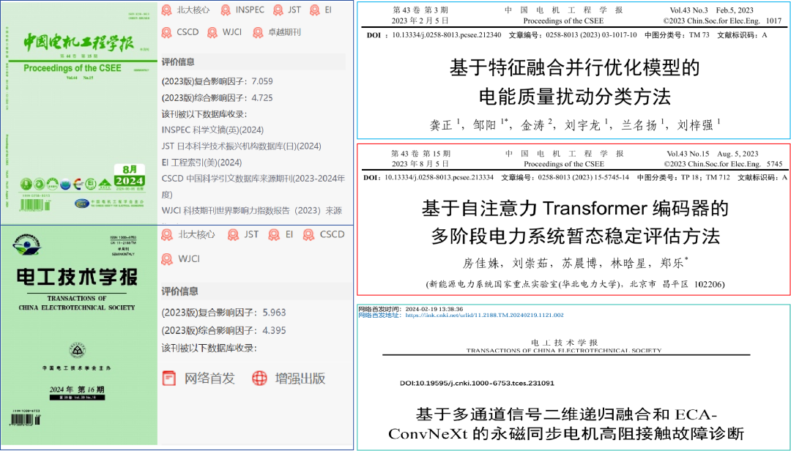
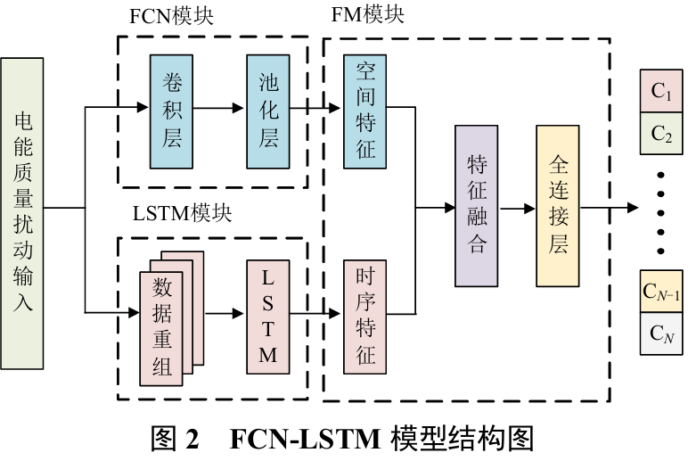
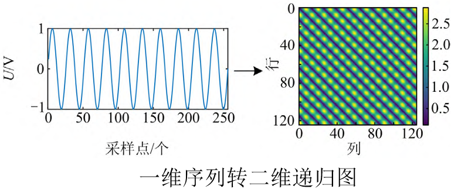
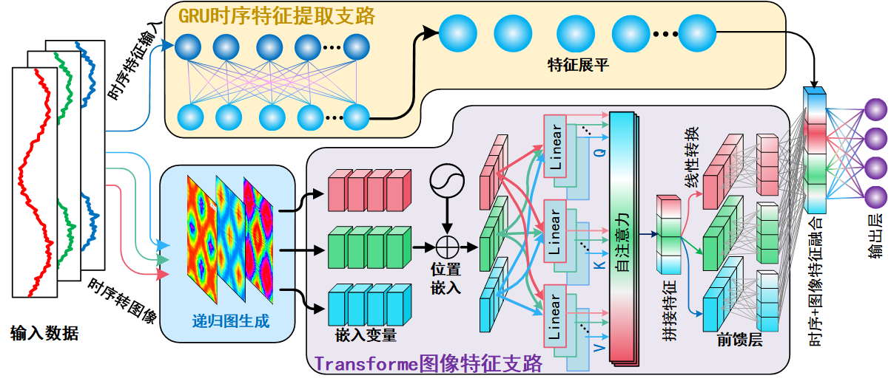
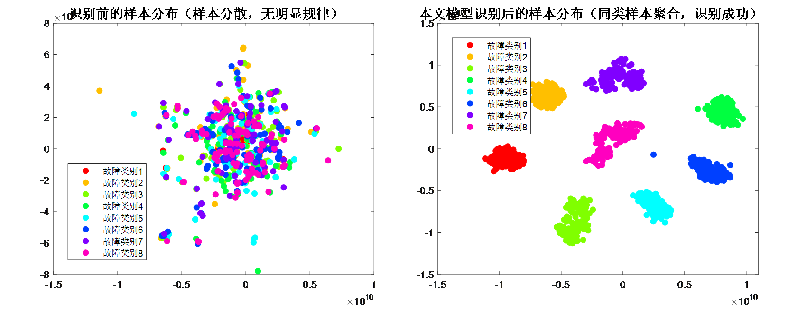
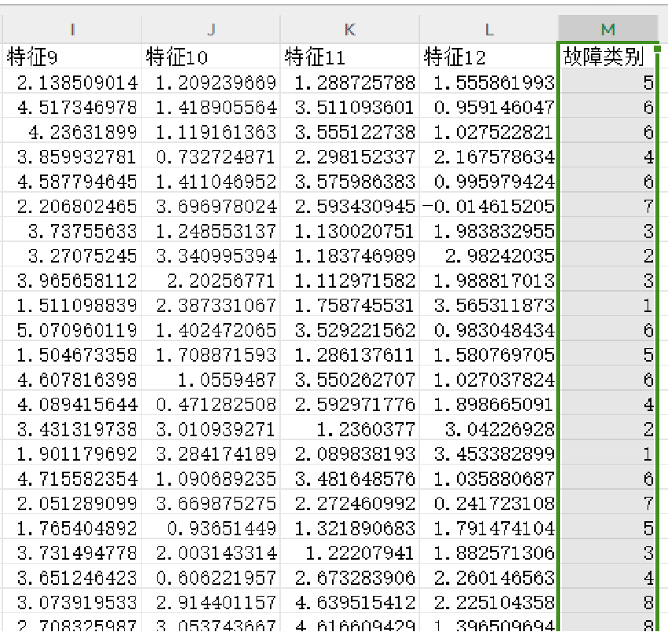
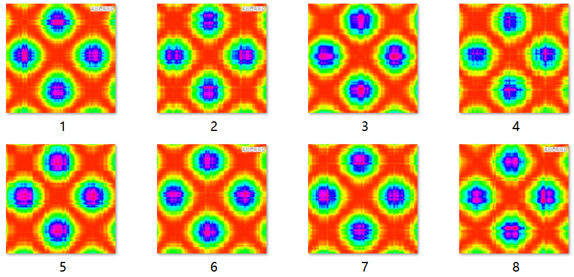
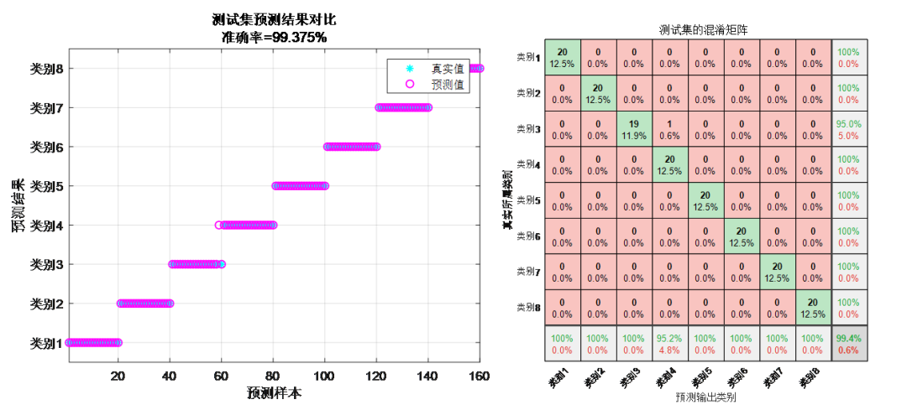
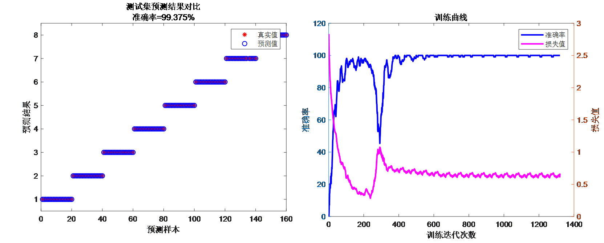

# Latest Hotspot! Integrated Innovation! Transformer + Parallel Network: Local Features + Global Features; Time-series Features + Spatial Features! A Classification Prediction Program for Beginners!

Applicable Platform: Matlab2023b and above.
References:
1. Chinese top-tier EI journal "Journal of Electrical Engineering" (JEE): "Multi-stage transient stability assessment method based on the Transformer encoder in power systems." The Transformer encoder method used in this paper is from the document.
2. Chinese top-tier EI journal "Journal of Electrical Engineering" (JEE): "Electric power quality disturbance classification method based on feature fusion and parallel optimization model." This feature fusion and parallel optimization model is mentioned in the reference.
3. Chinese top-tier EI journal "Journal of Electrical Technology" (JET): "High-resistance contact fault diagnosis of permanent magnet synchronous motors based on multi-channel signal two-dimensional recursive fusion and ECAConvNeXt." The one-dimensional time series transformation recursive graph method is discussed in this document.
In data preprocessing, the reference mentions using the phase space reconstruction method of recursive graphs to convert one-dimensional waveforms into two-dimensional images;
In image feature extraction, the reference uses a Transformer model to extract spatial features from recursive graphs.
The structure of the fault identification model is explained in the reference: constructing a parallel optimization model with branch 1 using time series waveform input, GRU neural network extracting time series temporal features, branch 2 using the Transformer encoder to extract image features, achieving fusion of both time series and image spatial features to form a multimodal fusion fault identification program through parallel bidirectional transformer-GRU-parallel dual-branch optimization.
Interpretation of Reference One:
Work interpretation for reference one: Building a power system transient stability assessment method based on the Transformer encoder, which utilizes attention mechanisms to achieve global receptive fields, enabling the model to quickly capture the global state dependencies between the power system's preceding and following moments, demonstrating good interpretability and high fault recognition accuracy.
The literature two innovations: The method uses a feature fusion approach, employing Fully Convolutional Neural Networks (FCN) and Long Short-Term Memory Networks (LSTM) to parallelly mine high-dimensional features of power quality disturbances in both spatial and temporal dimensions. The concurrent fusion of temporal and spatial features enhances the model's classification performance.
Literature three interpretation:
Literature three interpretation: By introducing recursive graph methods, one-dimensional current signal is mapped into two-dimensional images, enhancing the richness of fault characteristic information and eliminating the impact of manual feature extraction, achieving enhanced display of fault characteristics. Subsequently, using Convolutional Neural Networks with attention mechanisms and constructing residual connections, effective fault classification is achieved.
Combining the Transformer model from literature one with the RP recursive graph transformation method from literature three, and the bifurcated dual-path parallel feature fusion model from literature two, we propose a fault identification program based on Transformer, recursive graph (RP), and bifurcated dual-path parallel multimodal fusion: A parallel bifurcated dual-path optimized multimodal fusion fault identification program using 1D-2D-BiTransformer-GRU. This program has significant innovations and is sufficient for high-level academic papers, as well as simple tasks such as master's theses and course designs.
1D-2D-BiTransformer-GRU parallel bifurcated dual-path optimized multimodal fusion fault identification program:
With only raw fault waveform data, it can transform a one-dimensional sequence into a two-dimensional recursive image according to the waveform data.
By introducing the Transformer model to extract spatial features from the recursive images, this avoids the impact of manual feature extraction during fault signal processing. It performs global feature weighting to enhance the model's ability to extract global features.
Building a bifurcated dual-path model integrates one-dimensional time series signals and two-dimensional images, allowing for the comprehensive use of different modalities to describe the data more accurately. This helps to extract more rich and distinctive features, thereby improving classification and recognition accuracy.
① A path is dedicated to image input, where Transformer encoding branches extract spatial features of recursive images; ② Another path directly inputs fault waveforms and employs GRU to extract temporal features, fusing high-dimensional image features with one-dimensional temporal features; ③ The internal multi-head attention mechanism effectively grasps the contribution level of extracted features, focusing on enhancing key features to improve the accuracy of fault identification; ④ Additionally, evaluation metrics such as precision, recall, accuracy, F1 score are calculated. The fault identification process is as follows:
Seven innovative points:
1. Multimodal Fusion: The integration of one-dimensional time-series signals and two-dimensional images allows for the comprehensive utilization of information from different modalities, thereby more comprehensively describing the characteristics of data. This aids in extracting richer and more distinctive features, thereby enhancing the accuracy of classification and recognition.
2. Temporal Information Acquisition: GRU (Gated Recurrent Unit) is a type of recurrent neural network suitable for time-series data, capable of capturing dynamic changes and trends within one-dimensional temporal signals. By integrating the GRU with a novel Transformer, the algorithm can simultaneously consider both temporal and spatial features, further enhancing its performance.
3. Spatial Feature Learning: Transformer performs exceptionally well in global feature extraction, effectively learning spatial features and local patterns of images. Applying Transformer to image data processing can help extract features such as texture, shape, and edges of images, facilitating more accurate classification and fault identification.
4. Integration Advantage: By integrating information from different modalities, the algorithm can compensate for the limitations of one-dimensional time-series signals and two-dimensional images. For example, images may be more sensitive to certain fault patterns while sequential signals are more sensitive to others. Combining them can enhance the robustness and generalization ability of the algorithm.
5. Multi-head Self-Attention Mechanism: The fusion of multi-head attention mechanisms in Transformer effectively grasps the contribution of feature extraction, enhancing the focus on key features to improve the accuracy of fault identification.
6. Generalization Capability Enhancement: Multimodal fusion can help algorithms better understand the essential characteristics of data, thereby reducing the risk of overfitting and enhancing the algorithm's generalization capability on new data.
7. Interpretability: To improve model interpretability, the t-SNE interpretability algorithm is applied to visualize the feature maps of each branch module; compare the distribution of samples extracted by the original samples and those from the 1D-2D-BiTransformer-GRU multimodal fusion.
Applicable Fields: Suitable for various data classification scenarios, such as rolling bearing fault detection, transformer oil gas fault detection, power system transmission line fault areas, insulators, distribution networks, and disturbances in electric energy quality, etc., for recognition, diagnosis, and classification.
Data Format: Each row represents a waveform sample, with the last column being the fault type label of the sample.
Program Results: (Automatically converted from the above one-dimensional sequence into a recursive graph RP image)
Program Results:

## Images

<!-- PAYMENT_BLOCK -->

## Get this dataset

- Payment link (Stripe): [Buy now](https://buy.stripe.com/3cs8yP7sY87d0vu9AB)
- Payment QR code: 

<!-- /PAYMENT_BLOCK -->
